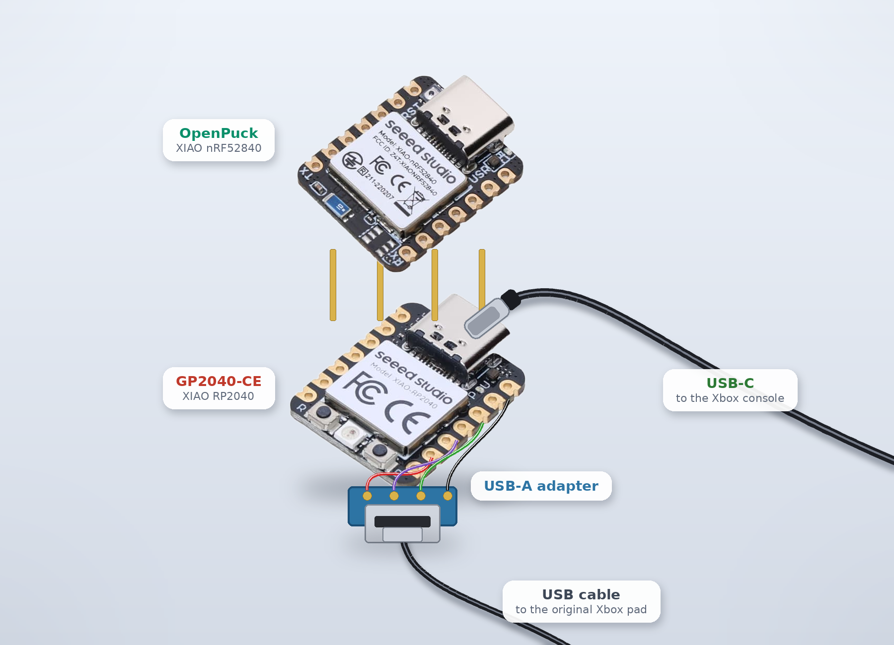

# SeriousPuck

Use a wireless **Steam Controller** (or any keyboard and mouse) on an **Xbox Series X|S**.

An RP2040 running [GP2040-CE](https://github.com/OpenStickCommunity/GP2040-CE) acts as an Xbox controller towards the console. An original Xbox pad plugged into the adapter's USB host is used only for Xbox authentication. For the Steam Controller, a second board (nRF52840 running [OpenPuck](https://github.com/safijari/openpuck)) receives the controller over its 2.4 GHz radio and hands the input to the RP2040 over UART.



## Status

| Part | State |
| --- | --- |
| RP2040 + GP2040-CE as Xbox One controller, auth through an original Xbox pad on the USB host | **works** (tested on an Xbox Series console) |
| Keyboard and mouse through a USB hub on the same host port | **works**: keyboard keys as buttons, **WASD as the left stick** and the **mouse as the right stick** (patch in [`patches/`](patches/)); mouse feel is only so-so because it is an analog stick |
| OpenPuck on a XIAO nRF52840 | not built or tested yet |
| nRF52840 -> RP2040 UART bridge, Steam Controller mapping (gyro, touchpads, back buttons), rumble | protocol and mapper are written and unit-testable (`firmware/`), not integrated into the board firmware yet |

The console does not need the pad after login: once you are logged in the pad can be unplugged and input keeps working until the console sleeps or turns off.

## Repository layout

| Path | What it is |
| --- | --- |
| [`docs/build-guide.md`](docs/build-guide.md) | how to build it, step by step |
| [`docs/parts.md`](docs/parts.md) | parts list |
| [`docs/wiring.md`](docs/wiring.md) | pin-to-pin wiring |
| [`docs/protocol.md`](docs/protocol.md) | UART protocol between the two boards |
| [`docs/architecture.md`](docs/architecture.md) | original design brief (Polish) |
| [`docs/images/`](docs/images/) | wiring diagram and illustrations |
| [`firmware/`](firmware/) | portable protocol library and input mapper (host-buildable) |
| [`patches/`](patches/) | patch for GP2040-CE: keyboard left-stick keys and a better mouse-to-stick conversion |
| [`tools/`](tools/) | generator of the wiring diagram |

## Upstream sources

This repository contains only SeriousPuck's own files. The two upstream projects are separate checkouts, not part of this repository. The patch and the notes refer to these exact commits:

| Project | Commit |
| --- | --- |
| [GP2040-CE](https://github.com/OpenStickCommunity/GP2040-CE) (includes the Xbox auth relay, PR #1684) | `069d3108216c50f704601177e7cf850760ece68d` (v0.7.12-117) |
| [OpenPuck](https://github.com/safijari/openpuck) | `2a1e54bc77fb194c6c55ee968bc594fd5f7672f4` (0.9.59) |

```sh
git clone https://github.com/OpenStickCommunity/GP2040-CE.git
git -C GP2040-CE checkout 069d3108216c50f704601177e7cf850760ece68d
git -C GP2040-CE submodule update --init --recursive
git -C GP2040-CE apply ../seriouspuck/patches/gp2040-ce-keyboard-left-stick.patch   # optional: keyboard + mouse features
```

Then follow [`docs/build-guide.md`](docs/build-guide.md).

## Build the portable core

```sh
cmake -S . -B build
cmake --build build
```

Board firmware integration depends on the upstream OpenPuck and GP2040-CE trees; this repository does not claim a flashable OpenPuck build yet.
