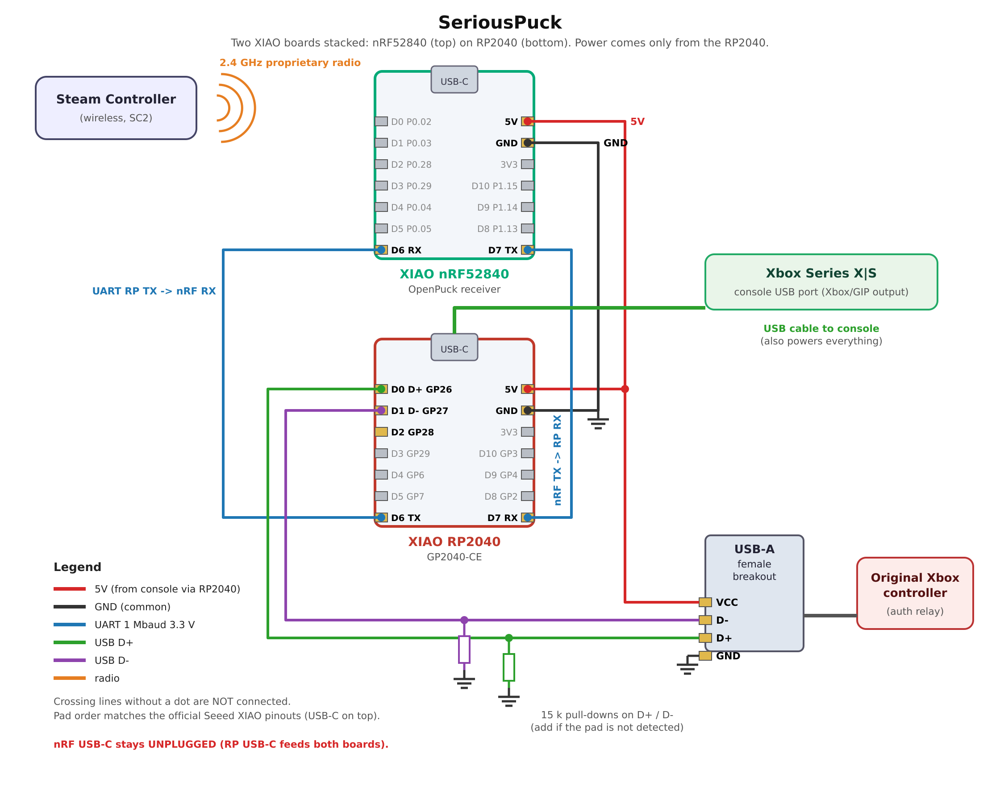

# Build guide



Two things can be built from this repository:

1. **RP2040-only adapter** (works today): original Xbox pad as the auth device, plus keyboard and mouse through a USB hub. Needs only the RP2040 board. Steps 1-4.
2. **Steam Controller adapter** (planned): adds the nRF52840 with OpenPuck and the UART bridge. Steps 1-6; the OpenPuck part and the bridge are not built or tested yet.

Parts: [parts.md](parts.md). Wiring: [wiring.md](wiring.md).

## 1. Get the sources

Clone this repository and, next to it, the two upstream projects at the pinned commits (see the README, "Upstream sources"):

```sh
git clone https://github.com/OpenStickCommunity/GP2040-CE.git
git -C GP2040-CE checkout 069d3108216c50f704601177e7cf850760ece68d
git -C GP2040-CE submodule update --init --recursive
git -C GP2040-CE apply ../seriouspuck/patches/gp2040-ce-keyboard-left-stick.patch   # keyboard left stick + better mouse
```

## 2. Flash GP2040-CE on the RP2040

1. Build GP2040-CE from your `GP2040-CE` checkout (Pico SDK 2.3.1 or newer) for your board: `WaveshareZero` for the RP2040-Zero, `SeeedXIAORP2040` for the XIAO RP2040 (only the RP2040-Zero build was tested; the patch does not depend on the board). Release `.uf2` files of upstream GP2040-CE work too, but they do not have the keyboard and mouse patch.
2. Hold BOOT while plugging in the USB-C cable and copy the `.uf2` to the `RPI-RP2` drive. The board reboots by itself.
3. Wait until the file is fully written before unplugging. An incomplete write leaves holes in the flash and the web config then fails to load (browser error `ERR_CONTENT_DECODING_FAILED`); just flash the file again.

## 3. Configure GP2040-CE (web config)

The web config is at http://192.168.7.1 while the board runs in config mode. Enter it by holding **S2 + B3 + B4 for 4 seconds** (see [wiring.md](wiring.md) for the keyboard variant), or by holding the S2 pin to GND while plugging in. The board has to be plugged into a computer, not the console.

| Where | Setting |
| --- | --- |
| Settings -> Input Mode | **Xbox One** (not XInput, which is only for Xbox 360) |
| Configuration -> Peripheral Mapping -> USB Host | enabled, D+ = GP26 on the XIAO (GP0 on the RP2040-Zero), D- is the next GPIO, Enable 5V unset |
| Configuration -> Pin Mapping | the pins used by the USB host and the UART empty. The RP2040-Zero config maps S1/S2 to GP0/GP1; the XIAO config maps D-pad directions to GP26/GP27 and S1 to GP1. The host pins then show as "Assigned to addon" |
| Configuration -> Add-ons | **Keyboard/Mouse Host** enabled, **Gamepad USB Host** disabled (incompatible with Keyboard/Mouse Host and not needed for auth) |

Authentication needs nothing more: with Xbox One mode and the USB host enabled, GP2040-CE relays the console's challenge to the original controller plugged into the host.

Keyboard and mouse (with the patch): keys are mapped to pad buttons in the Keyboard/Mouse Host add-on; defaults are W/S/A/D = left stick, arrows = D-pad, Shift/Z/Ctrl/Alt = A/B/X/Y, C/Space = LB/RB, V/X = LT/RT, 5/1 = View/Menu, 9 = Guide. The mouse moves the right stick (Right Analog); map its buttons to pad buttons and tune **Mouse Sensitivity** and **Mouse Dead Zone Offset** to the game's dead zone.

The settings survive a firmware flash. To go back to defaults flash a config-erase `.uf2` (it overwrites the last 32 KB of flash, `0x101F8000`).

## 4. Test the RP2040-only adapter

1. Plug the original pad into the USB-A socket (or a hub), plug the RP2040 into the console. The console should recognise a controller.
2. Log in. After that the pad can be unplugged and the keyboard keeps working until the console sleeps or turns off; the pad is needed again after that.
3. Add the keyboard, then the mouse, one at a time.

## 5. Flash OpenPuck on the nRF52840 (planned)

1. Install the Arduino IDE or arduino-cli with the Adafruit nRF52 core.
2. Clone [OpenPuck](https://github.com/safijari/openpuck) (commit `2a1e54b`), open `OpenPuck/OpenPuck` and select a board matching the XIAO nRF52840 (the project default is `adafruit:nrf52:feather52840`; check the LED pins for the XIAO variant).
3. Double-tap reset to enter the bootloader and upload. The board then shows up as a Steam Controller Puck (28de:1304) and pairs with the controller as described in the OpenPuck README.
4. Do this **before** stacking, using the nRF52840's own USB-C.

OpenPuck has not been built for the XIAO nRF52840 yet.

## 6. Solder the stack (planned)

See [wiring.md](wiring.md): four connections between the boards (5V, GND, D6, D7) and four wires to the USB-A socket. Put the RP2040 at the bottom and the nRF52840 on top, about 8-9 mm apart. The nRF52840's USB-C stays unplugged.

## Known unknowns

- Seeed's wiki gives no voltage range for the 5V pad on the nRF52840 board.
- The UART bridge, the Steam Controller mapping (gyro, touchpads, back buttons) and rumble are written as a library and a mapper (`firmware/`) but not integrated into the board firmware.
- The mouse is an analog stick to the game, so precise aiming is not possible.
