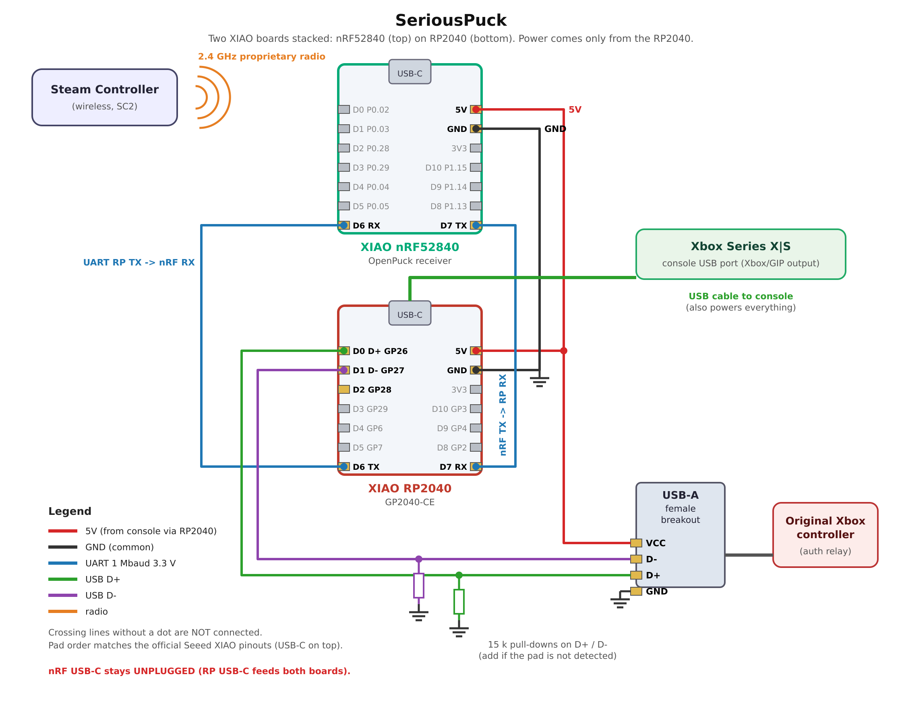

# Wiring

Pad order is the standard XIAO layout (USB-C at the top): left column D0..D6, right column 5V, GND, 3V3, D10..D7. It matches the official Seeed pinouts for both boards.

## Between the two XIAO boards

| nRF52840 (top) | RP2040 (bottom) | Note |
| --- | --- | --- |
| D6 (P1.11) = RX | D6 (GP0) = TX | UART, 1 Mbaud, 3.3 V |
| D7 (P1.12) = TX | D7 (GP1) = RX | UART |
| GND | GND | common ground |
| 5V | 5V | the nRF52840 is powered from the RP2040 |

Do not connect 3V3 to 3V3. The nRF52840's own USB-C stays unplugged; the RP2040's USB-C goes to the console and powers both boards. The two boards are stacked with about 8-9 mm between them so the USB-C connectors do not collide.

The UART pins in the nRF52840 firmware must be D6 = RX and D7 = TX because the pads are wired straight through.

## RP2040 to the USB-A socket (original pad, USB host on PIO)

| RP2040 pad | USB-A pin |
| --- | --- |
| 5V | VCC |
| D1 (GP27) | D- |
| D0 (GP26) | D+ |
| GND | GND |

In GP2040-CE: Peripheral Mapping -> USB Host, D+ = GP26 (D- is the next GPIO). The XIAO default pin mapping puts D-pad directions on GP26 and GP27 (and S1 on GP1, which is the UART RX pad): clear the pins you use for the host and for the UART in Pin Mapping.

Optional 15 kOhm resistors from D+ and from D- to GND. The prototype worked without them.

## Prototype board: Waveshare RP2040-Zero

The first prototype used a RP2040-Zero. There the host pins are GP0 (D+) and GP1 (D-) and the web config button is on GP28. The UART pins above do not apply, because GP0/GP1 are used by the host.

Never touch the 5V pad and GND with a probe or a wire at the same time. The first board died that way.

## Web config without a button

Hold S2 + B3 + B4 for 4 seconds to reboot into the web config (http://192.168.7.1). On a keyboard with the default Keyboard Host mapping that is the keys mapped to Menu, X and Y. If you cannot get in, hold the board's BOOT button while plugging it in and flash a config-erase UF2.
